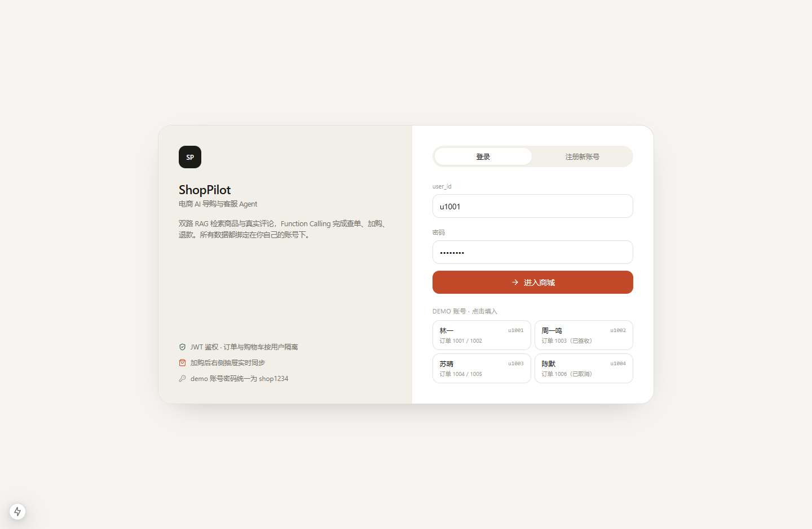
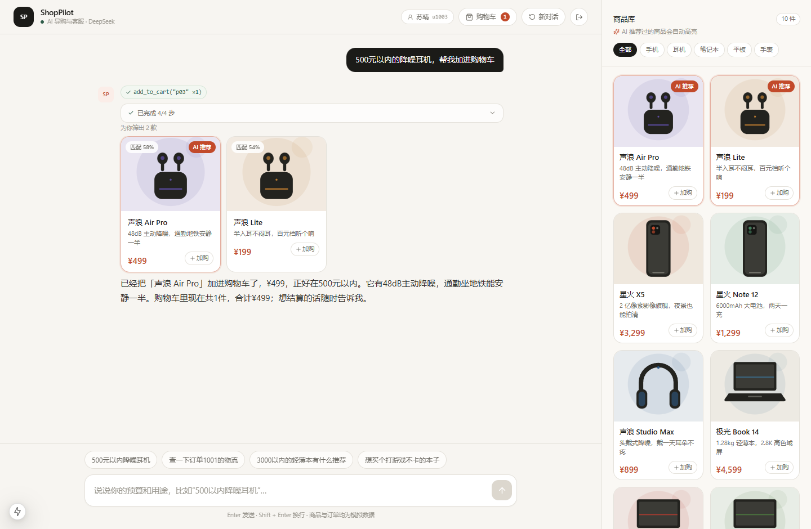
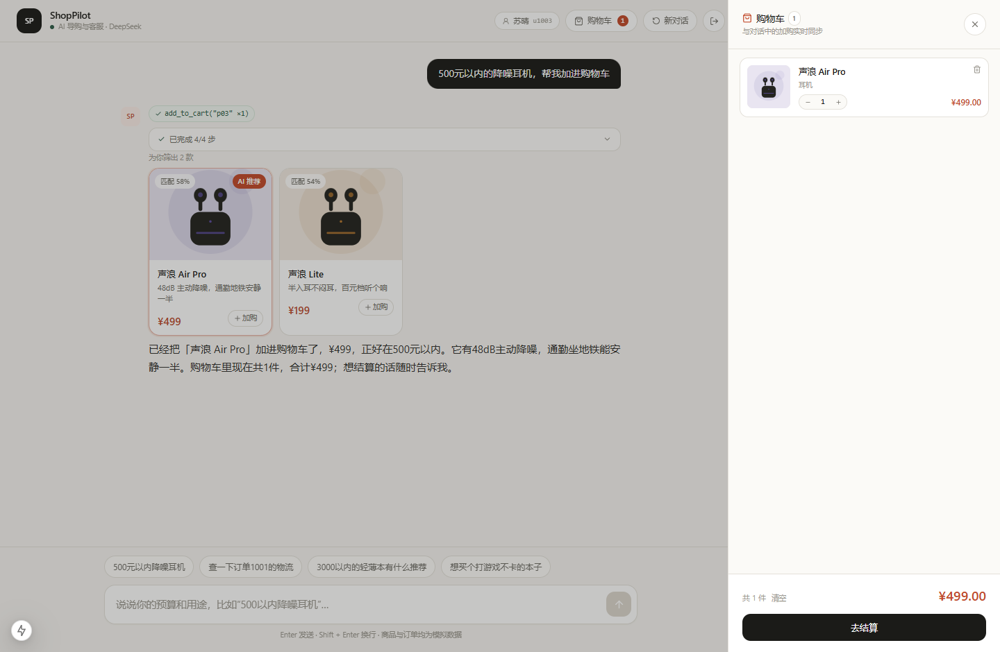
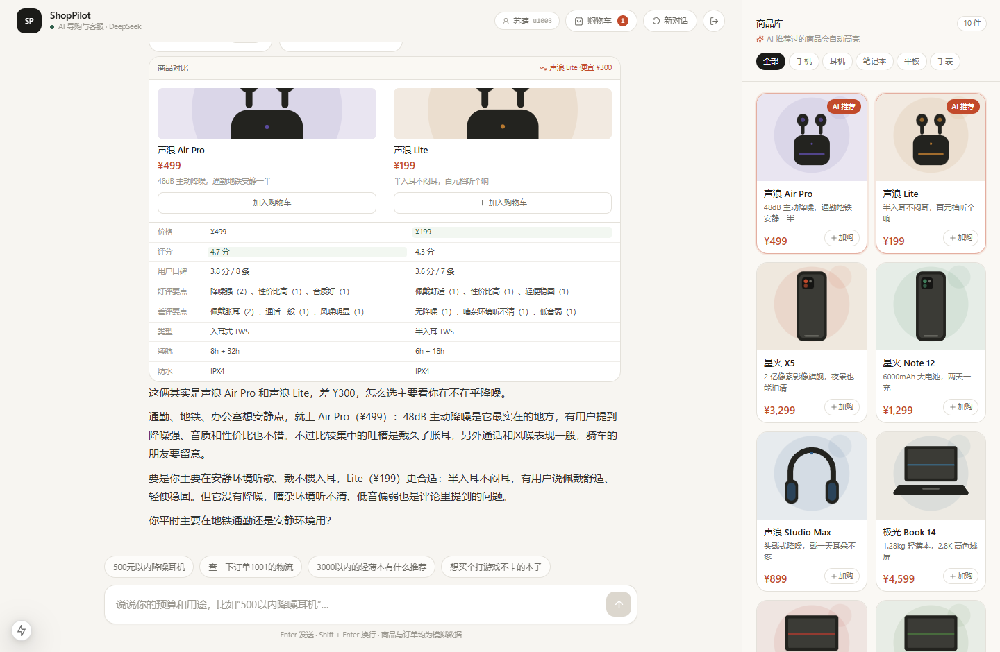
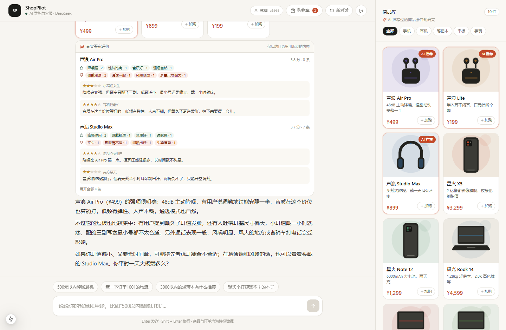
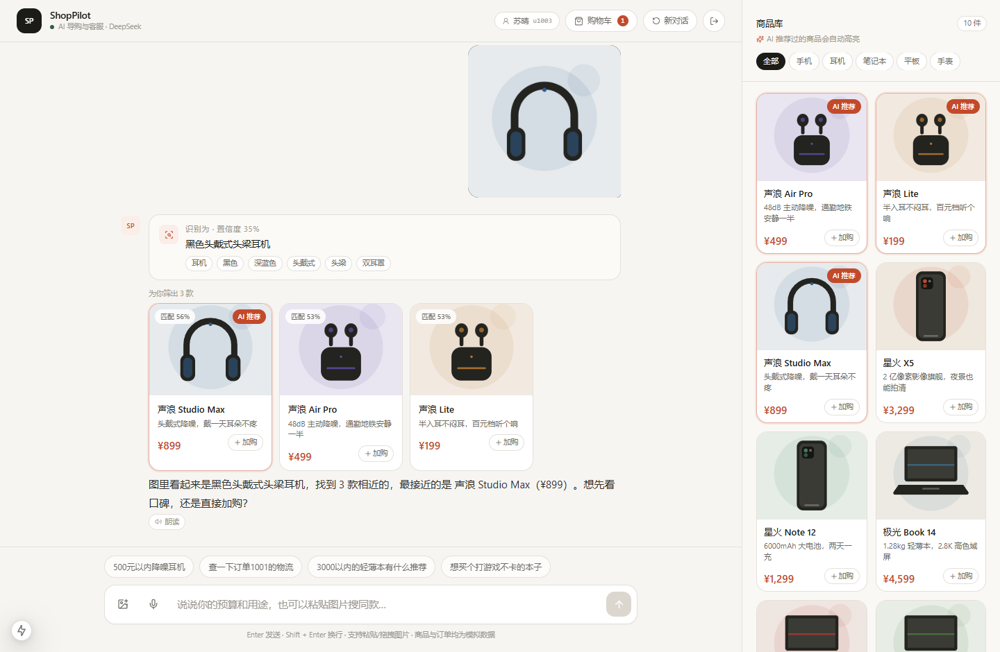
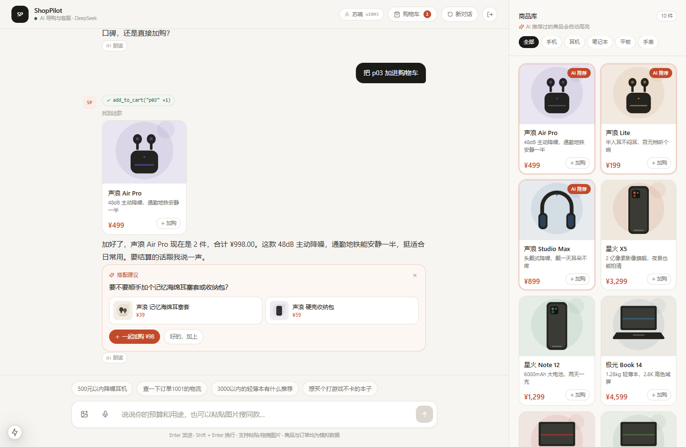
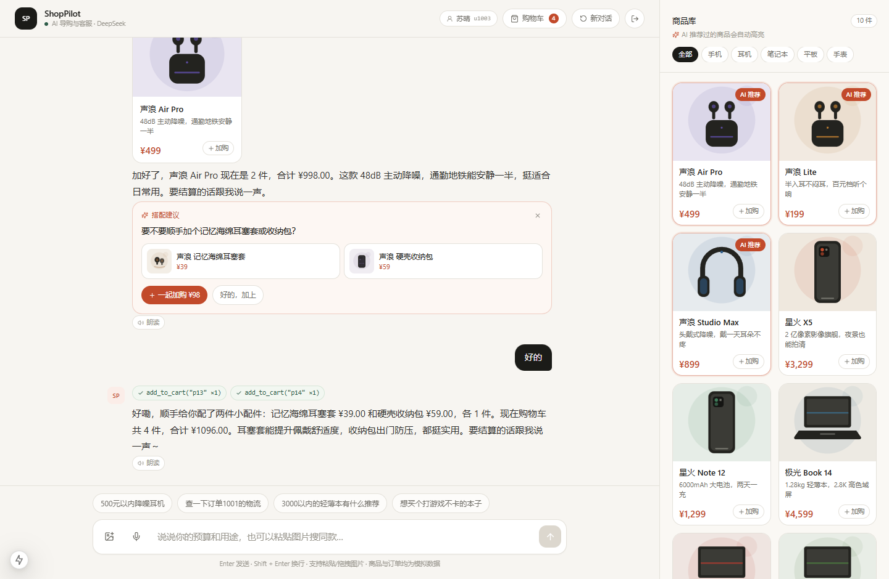
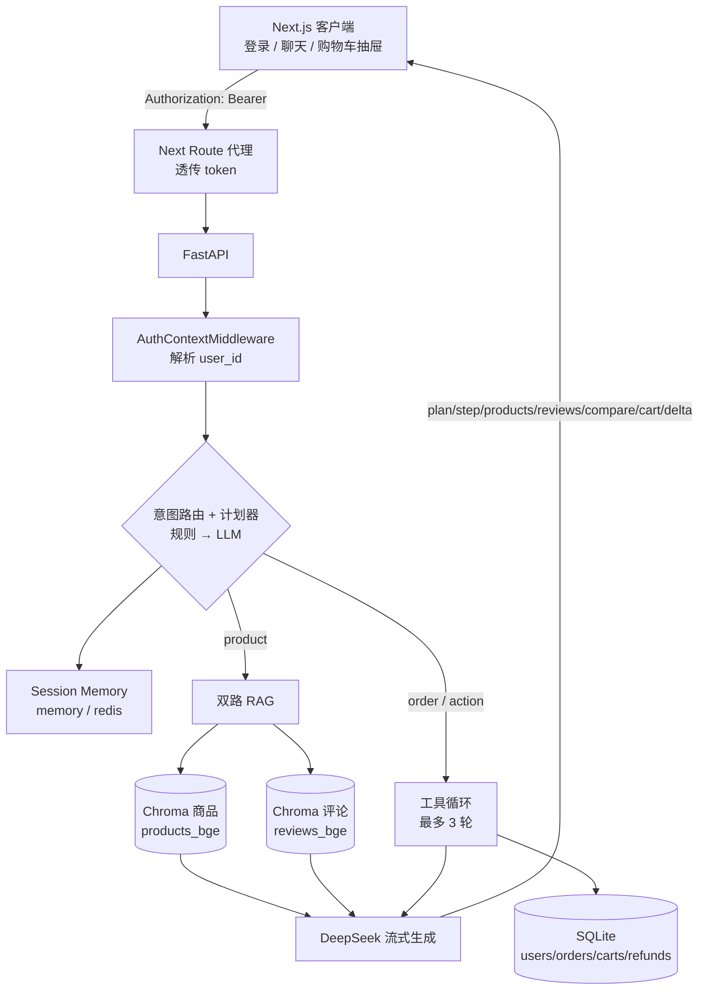

# ShopPilot · 电商 AI 智能导购与客服 Agent

基于 **DeepSeek + Chroma 双路 RAG + Function Calling + JWT + SSE 流式** 的电商导购 / 客服演示项目。
前端 Next.js + Tailwind，后端 FastAPI，全部数据本地模拟（SQLite + Chroma），无需外部服务即可跑通。

> **在线体验**：https://shoppilot-agent.app.workbuddy.host/?sharecode=BKX3XT2KHG
> 演示账号 `u1001` / `shop1234`（带 2 笔订单，方便试查单和退款），也可以直接注册新账号。

```
用户：500 元以内的降噪耳机，帮我加进购物车
AI  ：[计划] 思考 → 检索商品 → 调用加购工具 → 生成回复      ← 多步进度条
     ┌──────────────────────────┐
     │  声浪 Air Pro  ¥499      │  ← 同一路 SSE 下发的结构化商品卡片
     │  48dB 主动降噪 · 匹配 78% │
     └──────────────────────────┘
     [add_to_cart("p03" ×1)]                              ← 工具调用链
     已经放进购物车了，¥499 正好卡在预算内。        🛒 1        ← 抽屉实时 +1
```

## 界面预览

| 登录（JWT） | 检索 + 加购（进度条 / 工具链） |
|---|---|
|  |  |

| 购物车抽屉 | 两列对比 | 口碑（双路 RAG） |
|---|---|---|
|  |  |  |

| 拍图搜同款 | 主动搭配推荐 | 确认后自动加购 |
|---|---|---|
|  |  |  |

## 能力总览

| 维度 | 能力 | 实现要点 |
|---|---|---|
| 鉴权与安全 | 登录后所有接口带 JWT，服务端解析 `user_id` | bcrypt 存密码；ASGI 中间件只解析不拦截；`user_id` **永不进入**工具 JSON Schema，由服务端注入 |
| 业务工具 | `query_order` / `add_to_cart` / `request_refund` | 退款仅限「本人 + 已签收」；跨用户统一返回 `FORBIDDEN`，不泄露机主、金额、地址 |
| 多轮记忆 | 前端生成 `session_id`，后端保留最近 5 轮 | 指代消解（"那它多少钱"）、槽位继承、换货排除焦点商品；内存 / Redis 一键切换 |
| 双路 RAG | 商品参数向量 + 评论语义向量（独立集合） | 评论先按 `product_id $in [...]` 过滤再排序，只召回本商品评论；优缺点严格来自真实评论 |
| 高级交互 | 购物车抽屉、多步进度条、两列对比卡 | SSE 事件驱动，前端按到达顺序拼装有序 Block |
| 多模态 | 拍图搜同款 | 前端 canvas 压缩 → DeepSeek 视觉模型提特征（强制 JSON）→ 复用同一套 RAG；识别失败自动降级为文字检索 |
| 主动营销 | 加购后搭配推荐 | 品类→配件规则选品 + 模型一句话追问；`suggest` 事件带一键加购，回"好的"直接执行 |
| 语音 | 语音输入 + 朗读 | Web Speech API；不支持/无权限/网络不通都有明确提示，不静默失败 |

## 架构



**关键设计：先决策，后流式。** 路由、检索、工具调用都用同步调用拿确定结果，只有最终生成才流式推 token。流式 `tool_calls` 的 arguments 容易被截断，这个顺序避开了整类问题；同时前端能先看到计划与进度，而不是干等第一个 token。

## 快速开始

### 后端（Python 3.12）

```bash
cd backend
python -m venv .venv
.venv/Scripts/activate          # macOS/Linux: source .venv/bin/activate
pip install -r requirements.txt
pip install -r requirements-dev.txt   # 跑测试才需要（pytest / httpx）
cp .env.example .env            # 填入 DEEPSEEK_API_KEY 与 JWT_SECRET

python scripts/fetch_model.py   # 下载 bge-small-zh-v1.5 ONNX（约 95MB，走 hf-mirror）
python -m uvicorn app.main:app --reload --port 8000
```

首次启动会自动：建表 → 写入 4 个演示账号 / 6 笔订单 / 10 件商品 → 构建 68 条评论的两个 Chroma 集合。
`GET /api/health` 返回 `{"status":"ok","embedding":"bge","products":10,"reviews":68}`。

### 前端（Node 18+）

```bash
cd frontend
npm install
npm run dev     # http://localhost:3000
```

`frontend/.env.local` 里配置 `BACKEND_URL=http://127.0.0.1:8000`。

### 演示账号

密码统一 `shop1234`（登录页有快捷填充按钮）。

| user_id | 姓名 | 名下订单 |
|---|---|---|
| `u1001` | 林一 | 1001、1002 |
| `u1002` | 周一鸣 | 1003 |
| `u1003` | 苏晴 | 1004、1005 |
| `u1004` | 陈默 | 1006 |

想验证越权：用 `u1001` 登录后问"查一下订单 1003"，会得到"这笔订单不在你的账号下"，且不暴露任何字段。

### 远程演示（把链接发给外部同事）

不想买云服务器、只想临时让人看效果时，用 Cloudflare 快速隧道把本机服务映射到公网：

```bash
# 双击项目根目录的 demo-remote.bat 即可（Windows）
# 等价手动操作：
backend/.venv/Scripts/python -m uvicorn app.main:app --host 0.0.0.0 --port 8000
cd frontend && npm run dev -- -H 0.0.0.0 -p 3000
tools/cloudflared.exe tunnel --url http://127.0.0.1:3000
```

`demo-remote.bat` 会依次：检查/启动 8000 与 3000 → 预编译首页（避免同事首屏等编译）→ 建立隧道（QUIC 失败自动降级 http2）→ 从公网回连自检 → 打印并复制公网地址。

- 只需要穿透 **3000** 一个端口：浏览器只和 Next 通信，`app/api/[...path]` 与 `app/api/chat` 在服务端把请求转发给 8000，SSE 也是原样透传。
- 同事打开链接后用 `u1001 / shop1234` 登录，或自己注册。
- 限制：本机必须开机联网；窗口关掉链接立刻失效；免费版域名每次重启都会变（`*.trycloudflare.com`），演示前现场再发一次链接。
- 脚本自带掉线自愈：每 20 秒探活一次，连续 4 次不通或 cloudflared 进程退出，就自动重建隧道并打印新链接（所以中途断过一次也不用重开窗口，复制新链接即可）。

**链接突然打不开时的三步排查**

| 现象 | 原因 | 处理 |
|---|---|---|
| 黑窗口已关闭 / 报错退出 | 隧道进程没了，Cloudflare 立刻撤掉该临时域名 | 重新双击 `demo-remote.bat` |
| `http://localhost:3000` 能开、公网打不开 | 只是隧道断了，服务本身没事 | 等脚本自愈，或重开窗口 |
| `localhost:3000` 也打不开 | 本机服务挂了 | 看那个最小化的 cmd 窗口里的报错 |

另外：电脑睡眠、切换 Wi-Fi（家里→公司）、开关节点/代理，都会重置路由并掐断隧道。

## 单端口部署（长期在线的分享链接）

内网穿透依赖「你的电脑开着」，简历或长期分享需要一条稳定地址。做法是把前后端合成**一个进程、一个端口**：
FastAPI 既提供 `/api/*`，也把 Next.js 的静态产物挂在 `/`，浏览器与接口同源，不需要 Node 侧代理。

```bash
python scripts/build_deploy.py     # 构建前端静态产物 + 组装 dist/
cd dist && PORT=8080 python server.py
```

产物很小（约 24MB），结构如下：

```
dist/
  app/             后端代码
  web/             前端静态产物（next export 的 out/）
  data/models/     bge ONNX 模型（int8 量化，22.8MB，随包分发，启动不联网）
  requirements.txt
  server.py        读 PORT，bind 0.0.0.0
  .env             由脚本生成，含真实 key，不要提交
```

几个关键设计：

| 点 | 说明 |
|---|---|
| 静态导出 | `STATIC_EXPORT=1` 时 `next.config.ts` 切到 `output: "export"`；`app/api/*` 是本地开发用的代理，构建时会被临时移走（静态导出不允许 route handler） |
| 构建并发 | Windows 上 `/404` 与 `/_not-found` 会并发写同一个 `404.html` 导致 `EPERM`，用 `experimental.staticGenerationMaxConcurrency: 1` 串行化 |
| 模型 | 本地 bge 模型量化成 int8（91MB → 22.8MB）一起打包，启动只加载；检索结果与 fp32 基本一致（实测 0.725/0.699 vs 0.712/0.676） |
| 嵌入降级 | 模型缺失时依次尝试 fastembed 下载 → 离线 hash 嵌入，保证任何机器都能起来（hash 只能关键词匹配，召回会下降） |
| 鉴权头 | 托管平台网关可能覆写 `Authorization`，所以同时接受 `X-Auth-Token`；前端两个头都发，本地与线上都能用 |
| 数据 | SQLite 与 Chroma 都在容器本地，冷启动自动建表、重建索引；单实例用内存会话 |

## 环境变量（backend/.env）

| 变量 | 说明 |
|---|---|
| `DEEPSEEK_API_KEY` | 必填 |
| `LLM_MODEL` | 默认 `deepseek-chat`（`deepseek-reasoner` 不支持 function calling） |
| `EMBEDDING_PROVIDER` | `bge`（默认）或 `hash`（离线兜底） |
| `TOP_K` / `RAG_MIN_SCORE` | 商品召回条数与相似度阈值 |
| `REVIEW_TOP_K` / `REVIEW_MIN_SCORE` | 评论召回条数与阈值 |
| `MAX_TOOL_ROUNDS` | 单轮最多工具循环次数（默认 3，防死循环） |
| `JWT_SECRET` | **必改**。仍是默认值时启动日志会告警 |
| `JWT_EXPIRE_MINUTES` | token 有效期，默认 12 小时 |
| `LOGIN_MAX_ATTEMPTS` / `LOGIN_WINDOW_SECONDS` | 登录限流：300 秒内 5 次失败即 429 |
| `SESSION_BACKEND` | `memory`（默认）或 `redis`；Redis 连不上会自动降级并告警 |
| `SESSION_TTL_SECONDS` / `SESSION_MAX_TURNS` | 会话过期时间与记忆窗口（默认 5 轮） |
| `VISION_MODEL` | 识图模型，默认 `deepseek-v4-flash-vision-exp`（实验模型，允许换名） |
| `VISION_ENABLED` | 关掉后识图直接走文字兜底 |
| `IMAGE_MAX_BYTES` / `IMAGE_SEARCH_PER_MINUTE` | 单图上限（默认 8MB）与识图限流（默认 10 次/分钟） |
| `CROSS_SELL_ENABLED` | 加购后是否推荐配件 |
| `DB_FILE` | 留空用 `data/shop.db`；测试写 `test_shop.db` 做隔离 |

## API 一览

除登录/注册/商品/健康检查外，其余接口都要求 `Authorization: Bearer <token>`。

| 方法 | 路径 | 说明 |
|---|---|---|
| POST | `/api/auth/login` | `{user_id, password}` → `{token, user}`；失败限流 429 `TOO_MANY_ATTEMPTS` |
| POST | `/api/auth/register` | 注册新账号（密码 ≥6 位，用户名重复返回 400） |
| GET | `/api/auth/me` | 校验 token、恢复登录态 |
| POST | `/api/chat/stream` | **SSE 主入口**，body `{message, session_id}` |
| POST | `/api/chat` | 非流式聚合版，便于调试和 curl |
| GET | `/api/cart` | 当前用户购物车（含小计） |
| POST | `/api/cart/items` | `{product_id, quantity}`，同商品累加 |
| PATCH | `/api/cart/items/{id}` | 改数量，传 0 等于删除 |
| DELETE | `/api/cart/items/{id}` · `/api/cart` | 删一条 / 清空 |
| GET | `/api/orders` | 只返回自己的订单 |
| GET | `/api/orders/{id}` | 别人的订单一律 404（不暴露存在性） |
| POST | `/api/orders/{id}/refund` | 403 越权 / 404 不存在 / 409 状态不允许 |
| GET | `/api/orders/refunds` | 退款记录 |
| POST | `/api/search/image` | 拍图搜同款：`{image_base64, mime, session_id, hint?}` → 特征 + 商品卡 |
| GET | `/api/products` | 商品列表，支持 `keyword` / `category` / `max_price` |
| GET | `/api/products/compare?ids=p03,p04` | 两列对比数据（含口碑与规格并集） |
| GET | `/api/products/{id}` | 详情 + 评论汇总 |
| GET | `/api/session/{id}` | 查看会话记忆（调试用） |
| DELETE | `/api/session/{id}` | 「新对话」时清空上下文 |
| GET | `/api/health` | 健康检查（含集合条数） |

## SSE 事件协议 v2

`POST /api/chat/stream`，`Content-Type: text/event-stream`。事件按业务顺序下发，前端按到达顺序追加 Block。

| event | data | 说明 |
|---|---|---|
| `meta` | `{intent, confidence, source, session_id, message_id}` | 路由结果，先于一切内容 |
| `plan` | `{plan_id, steps[], show}` | 任务拆解；只有 ≥2 个任务才展示进度条 |
| `step` | `{step_id, status, label}` | `running` / `done` / `failed`，驱动进度条 |
| `status` | `{stage, text}` | 轻量提示（"正在检索商品…"） |
| `products` | `{items[], mode, slot}` | 结构化商品卡；`mode=explicit` 表示用户点名 |
| `reviews` | `{product_id, summary}` | 口碑汇总：评分、星级分布、好评/差评要点、原文引用 |
| `compare` | `{left, right, rows[], verdict}` | 两列对比卡（价格/评分/口碑/规格并集） |
| `tool_call` | `{name, args}` | `query_order` / `add_to_cart` / `request_refund` |
| `tool_result` | `{name, ok, order?, cart?, refund?}` | 工具返回；`ok=false` 带 `code` |
| `cart` | `{items[], total, count}` | 购物车快照，前端整体覆盖（不做增量合并） |
| `refund` | `{refund_id, order_id, amount, status}` | 退款受理结果 |
| `suggest` | `{text, items[], product_ids[], source_product_id}` | 加购后的搭配推荐，前端渲染成可一键加购的卡片 |
| `delta` | `{text}` | 打字机增量 |
| `done` | `{intent, plan_id, chars, product_ids, cart_count, refund_id}` | 收尾 |
| `error` | `{code, message}` | 降级提示，流随即结束 |

```
event: step
data: {"step_id":"cart","status":"running","label":"正在调用加购工具"}

event: cart
data: {"items":[{"product_id":"p03","name":"声浪 Air Pro","quantity":1,"price":499}],"total":499,"count":1}
```

## 三个杀手级功能

### 拍图搜同款

```
选图/粘贴/拖拽 → canvas 压到 768px → POST /api/search/image
  → 视觉模型（deepseek-v4-flash-vision-exp）提特征 → 关键词 + 品类槽位 → 同一套 Chroma 检索
  → 特征 chips + 商品卡 + 会话焦点落库（接着问"这个多少钱"能指代）
```

- **传输**：客户端压成 base64 再传，不用 multipart，和现有 JSON 代理天然兼容；原图不落盘。
- **校验**：MIME 白名单 + base64 解码后 ≤8MB + **magic bytes 嗅探**（后缀写 png、实际是 jpeg 也能识破），每用户 10 次/分钟限流。
- **降级**：识图超时/无 key/模型返回空，一律退化成"用你打的字 + 文件名"检索，前端标"文字兜底检索"，链路不断。
- **提示词**：只描述看得见的特征，不猜品牌型号；`category` 只允许 5 个品类之一，`confidence` 低于预期就让用户补一句话。

### 主动搭配推荐

加购成功的瞬间（`stream_tool_turn` 里 `yield sse.CART` 之后）种一个推荐种子，等回答流完再生成文案——**不拖慢第一个 token**：

1. 规则选品：手机→快充头/防摔壳，耳机→耳塞套/收纳包，笔记本→扩展坞/内胆包，平板→触控笔，手表→表带；已在购物车的跳过；
2. 模型写一句 ≤34 字追问（两件时要求用"和"而不是"或者"），失败用模板；
3. 下发 `suggest` 事件，前端渲染成带缩略图和一键加购的卡片；
4. 用户点"好的，加上"或回一句"好的"：`session.pending_suggestion` 命中，规划器直接产出 `add_to_cart`，按清单逐件加购，不再确认；
5. `pending` 只在**一轮内有效**，用户没接话就作废，避免几轮之后突然"好的"也触发加购。

配件是 8 个独立 SKU（p11–p18），只进 `LOOKUP_MAP` 不进向量语料——否则"500 元以内降噪耳机"会把耳塞套召回。

### 语音输入与朗读

- 麦克风：`webkitSpeechRecognition`（zh-CN，`interimResults`），中间结果实时写进输入框，停止后可直接编辑再发送；不支持的浏览器不显示按钮。
- 错误兜底：权限拒绝、无设备、以及 Chrome 在国内常见的 `network`（识别服务在境外）都有中文提示，不会"点了没反应"。
- 朗读：`speechSynthesis` 播报 AI 最终答复，气泡上切换"朗读/停止"；Markdown 符号会先清掉再读。

## 四大维度落地细节

### 1. 安全防线

- `user_id` 不在任何工具的 JSON Schema 里（有专门的用例断言这点），模型无法伪造身份；执行时机由服务端从 token 注入。
- 越权统一返回 `FORBIDDEN`，**不区分**"订单不存在"和"不是你的订单"，避免通过错误文案枚举订单号。
- `GET /api/orders/{id}` 对他人订单直接 404；退款接口把业务错误码映射成 403/404/409。
- 提示词层再加一道：涉及查单/退款必须确认是本人账号下的订单，绝不复述他人信息。
- 登录失败滑动窗口限流（内存实现），超限 429，避免密码爆破。

### 2. 多轮记忆

`SessionState` 保存 `deque(maxlen=10)`（5 轮问答）+ `focus_product_id` / `last_product_ids` / `last_category` / `last_budget_max`。

- **指代消解**：命中「它 / 这个 / 那款 / 这款 / 第一个」或「这 + 品类」时，把问句重写成 `"{焦点商品名} {原句}"` 再检索，并把焦点商品钉在首位。
- **槽位继承**：上一轮"500 元以内"的预算会被继承，用户说"再便宜点"才会覆盖。
- **换货语义**：识别"还有别的吗 / 换一个"，主动排除当前焦点商品。
- **隔离**：`session_id` 与 `user_id` 绑定，换账号复用同一 session_id 会直接丢弃旧状态。
- 切换 Redis 只需 `SESSION_BACKEND=redis`；Redis 不可用时自动回落内存，不阻塞请求。

### 3. 双路 RAG

- 68 条评论（每件商品 6–8 条，好评差评都有），独立集合 `reviews_{embedder}`，文档元数据带 `product_id`、`rating`、`pros`、`cons`。
- 「这耳机有什么优缺点」触发两路检索：商品参数（价格/降噪深度/续航）+ 评论语义（"戴久了夹耳朵"这类说法能召回）。
- **先过滤再排序**：`where={"product_id": {"$in": [...]}}` 保证不会混入别的商品的差评。
- 喂给模型的评论块前缀写明「只能据此归纳，不得编造」；优缺点计数来自评论标签，不按星级过滤（3 星也可能夸降噪）。
- 对比卡的口碑行同样取自评论汇总，两列并列，方便看"贵 300 块到底值不值"。

### 4. 前端交互

- **购物车抽屉**：右侧滑出，数量步进 / 删除 / 清空；`cart` 事件到达即刷新，顶部角标实时跳动。
- **多步进度条**：`plan` + `step` 驱动，跑完自动折叠成一行"已完成 4/4 步"，不占屏幕。
- **对比卡**：两列表格，差异行高亮，顶部一句话结论。
- **消息块**：一条回复由有序 `Block[]` 组成（plan / text / products / reviews / compare / order / refund / tool），工具调用 chips 聚合在气泡顶部。
- 401 统一拦截：token 失效自动清本地态并回到登录卡。

## 数据库表结构

```sql
users(user_id PK, name, password_hash, created_at)
orders(order_id PK, user_id, product_name, amount, status, address,
       tracking_no, created_at, refund_status)
order_events(id PK, order_id, kind, title, detail, created_at)   -- kind: ship/deliver/refund
carts(id PK, user_id, product_id, quantity, created_at, updated_at,
      UNIQUE(user_id, product_id), CHECK(quantity BETWEEN 1 AND 99))
refunds(refund_id PK, order_id UNIQUE, user_id, amount, reason, status, created_at)
```

迁移是**追加式**的：启动时用 `PRAGMA table_info` 比对，缺列才 `ALTER TABLE`，并回填老数据的 `user_id`，不会清库。

## 测试

```bash
cd backend
pytest                        # 227 passed, 4 deselected（默认跳过 live）
pytest -m live                # 真实调用 DeepSeek
TEST_EMBEDDING_PROVIDER=hash pytest   # 无模型/无网络时用离线嵌入
```

| 文件 | 覆盖重点 |
|---|---|
| `test_auth.py` | 登录/注册/重复用户名/弱密码、密码错误、限流 429、过期 token、伪造签名、乱码 token、未登录 401 |
| `test_cart.py` | 同商品累加、按名称模糊引用、非法数量、超库存、改量/删除/清空、用户隔离、API 往返 |
| `test_refund.py` | 本人已签收成功、重复申请幂等、跨用户拒绝、未签收拒绝、取消单拒绝、不存在的单、越权查单不可见、HTTP 状态码 403/404/409 |
| `test_memory.py` | 5 轮窗口、指代重写、"还有别的"排除焦点、槽位继承与覆盖、非追问不误判、跨用户隔离、TTL 过期、Redis 降级、多轮编排 |
| `test_review_rag.py` | 语料质量（每件 5–10 条且有好有差）、标签合法性、集合 68 条、商品过滤不串味、语义召回、汇总统计、提示词禁止编造、`reviews` 事件只含本商品 |
| `test_rag_recall.py` | 「500 元以内降噪耳机」→ Top1 必须是 ¥499 的 Air Pro；预算硬约束不越界；分数单调性 |
| `test_tool_calling.py` | 订单号正则（8 种说法）、tool_calls 协议解析、**Schema 不含 user_id**、工具执行、加购/退款事件流、模型漏调工具时的兜底 |
| `test_sse_api.py` | 事件顺序（`meta` 先于 `products`）、计划 + 加购全链路、评论/对比事件、退款、未登录拦截、非流式端点、参数校验 422 |
| `test_planner.py` | 加购说法（加进/放到/来一个/下单）都产出 `add_to_cart`；"购物车里有什么"不误触发；对比锁定两件商品；退款需订单号；退款政策问句不算动作；步骤顺序固定；单任务不画进度条 |
| `test_vision.py` | 图片解码与 magic bytes 嗅探、格式/大小/伪造拦截、特征归一化、识图失败降级、限流 429、会话焦点落库 |
| `test_cross_sell.py` | 品类→配件映射、已在购物车的排除、模板兜底、确认话术边界、`pending` 一轮内失效、确认后按清单加购 |
| `test_slots.py` / `test_intent.py` | 预算表达（`500以内`/`三千`/`5百`/区间）、品类、规则命中不调模型、LLM 失败降级 |

RAG 用例**不打桩**：提示词好坏难测，但"到底召回了什么"可以精确断言。

## 目录结构

```
backend/
  app/
    core/     auth.py（JWT/bcrypt/限流/中间件） session.py（记忆 + 指代消解）
              planner.py（任务拆解） slots.py（槽位抽取） intent.py（路由） sse.py（事件编码）
    rag/      products.py（10 件 + 8 个配件） reviews.py（68 条评论） vision.py（多模态识图）
              store.py review_store.py embedding.py
    agents/   orchestrator.py（主编排） guide.py（RAG 生成） tool_loop.py（工具循环）
              compare.py（对比） cross_sell.py（搭配推荐） order.py（工具协议 + 兼容层）
    tools/    db.py（建表/迁移/种子） orders.py cart.py refunds.py
    routers/  auth cart catalog chat orders search session
  scripts/    fetch_model.py
  tests/      9 个测试文件
frontend/
  app/api/    chat/stream/route.ts（SSE 代理） [...path]/route.ts（通用代理，透传 token）
              ↑ 仅本地开发用；静态导出时由构建脚本临时移出
  components/ ShopPilot AppHeader LoginCard ChatStream Composer ProductRail ProductCard
              CartDrawer blocks/{MessageBlocks,PlanProgress,ProductRow,CompareCard,
                               ReviewSummary,OrderCard,RefundCard}
  lib/        api.ts（401 自动登出） auth.ts sse.ts cart.tsx（Context）
              image.ts（canvas 压缩） speech.ts（识别 + 朗读） types.ts
  public/products/*.svg（本地商品插画，无外网依赖）
scripts/      build_deploy.py（静态构建 + 组装 dist/）
tools/        cloudflared.exe（首次运行自动下载，约 53MB，不入库）
demo-remote.bat / demo-remote.ps1   一键起服务 + 公网隧道 + 自检
```

## 设计取舍

1. **RAG 不做纯向量检索。** "500 元以内"是硬约束，纯相似度必然召回 599 元的商品。先抽预算/品类做 `where` 过滤，再在候选集内排序；候选集为空才逐级放宽。
2. **评论先过滤再排序。** 反过来的话，语义相近的别的商品的差评会污染结论——这是优缺点场景最致命的一类幻觉。
3. **计划由规则派生，模型只填参数。** 步骤（思考/检索/评论/对比/查单/加购/退款/回答）由确定性逻辑算出来，模型只负责从自然语言里抽 `product_id`、`quantity`、`order_id`。这样进度条不会因为模型抽风而错乱，兜底也简单。
4. **`user_id` 不进 Schema。** 让模型"自觉"带上用户身份，等于把越权防线交给概率。身份只能来自 token。
5. **购物车快照整体覆盖。** 增量合并要处理乱序和丢包，SSE 场景不值当；后端一次给全量，前端直接替换。
6. **模型不做事实来源。** 价格、库存、物流、评论全部来自检索/数据库注入的上下文，提示词明确禁止编造。

## 已知限制

- 会话记忆默认在进程内存，多副本需要 `SESSION_BACKEND=redis`。
- 登录限流是单机内存计数，集群需要挪到 Redis。
- 退款只落库不接支付网关，"加购即完成"是演示语义，未接订单/支付系统。
- Chroma 用本地持久化目录，单机单进程；多副本要换服务端模式。
- 10 件商品 / 68 条评论的语料规模很小，召回指标不具备生产参考意义。
- 商品图是本地 SVG 插画，非真实商品图。
- 识图模型是 `-exp` 实验版：识别品类/形态稳定，细粒度型号不可靠，所以提示词禁止猜型号。
- Chrome 的语音识别走境外服务，国内网络可能报 `network`，此时只能键盘输入（朗读不受影响，走系统 TTS）。
- 上传图片只在内存里过一遍，不落盘也不入历史；刷新页面后气泡里的图会消失。
